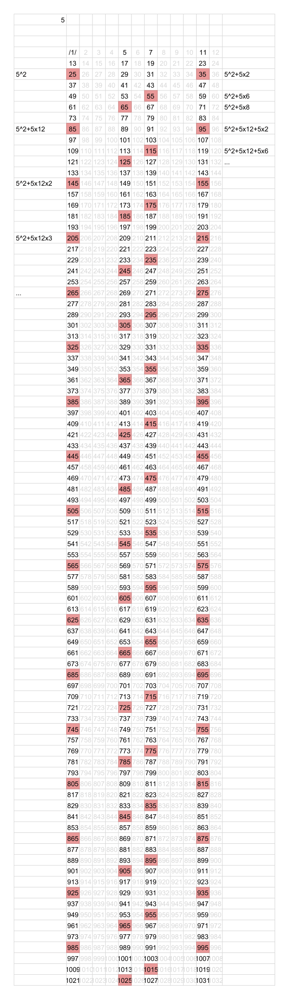
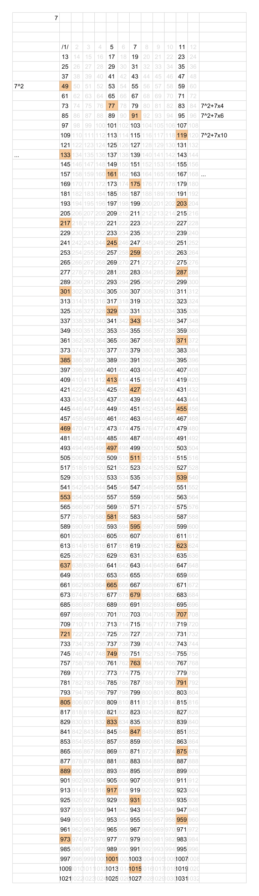
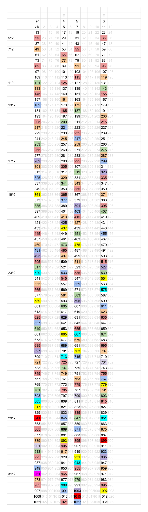

# Primes


*2021: written before git, first committed in 2026*

A small, self-guessed prime number generator in Python.

## How it works

Every prime greater than 3 leaves a remainder of 1, 5, 7, or 11 when divided by 12. `primes_rows` walks these four number lines at once (`row = [1, 5, 7, 11]`, each stepping by 12), and for each candidate checks it against a running list of known primes' future multiples — rather than testing divisibility directly. If a candidate matches one of those tracked "not-prime" values, it's composite and the tracker jumps ahead by `12 * prime`; otherwise it's prime, and it gets its own tracker seeded from its square.

## Usage

Uses only the Python standard library, nothing to install.

```bash
python primes.py
```

Prints every prime from 5 upward (2 and 3 are left out), one per line as `[prime, [tracker values]]`. The limit set by `primes_rows(1020)` at the bottom of the file is checked per block of 12, so a few numbers past it can appear (for 1020 the last prime printed is 1019). Change that number to adjust the range.

## Tech

Python 3.10.

## How this was found

Before any code existed, this was worked out by hand in a spreadsheet. Laying numbers 1 through 1000+ out in rows of 12 made the pattern visible immediately. From there, tracking where each prime's multiples actually fell, by hand and cell by cell, revealed the exact offsets now hardcoded in `primes_rows`: `+2, +6, +8` times the prime for one pair of columns, and `+4, +6, +10` for the other.

The third sheet below ("All primes") colors every number each prime (5, 7, 11, 13...) predicts as composite, a hand-run, color-coded version of the algorithm the code now runs automatically.

**In the "All primes" sheet, the numbers left uncolored in those four columns are the primes themselves.**

## Final images

*Legend: P = Pythagorean primes column, G = Gaussian primes column, E = Eisenstein primes (without imaginary part) column.*

| Prime of 5 | Prime of 7 | All primes |
|---|---|---|
| [](readme-images/sheet-5.png) | [](readme-images/sheet-7.png) | [](readme-images/sheet-all.png) |

## License

MIT License — see [LICENSE](LICENSE).

<div align="right">

*README written with AI assistance.*

</div>
